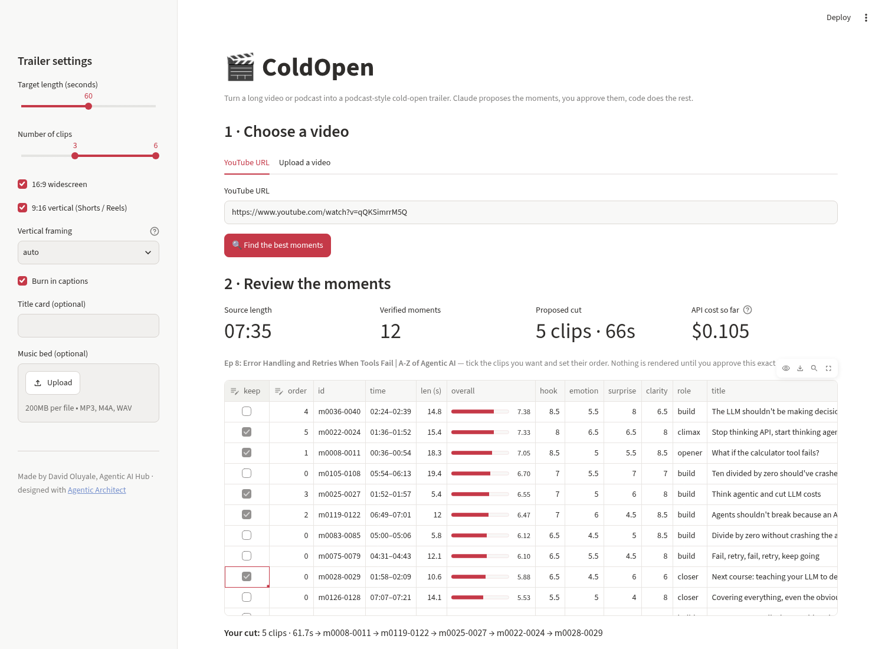
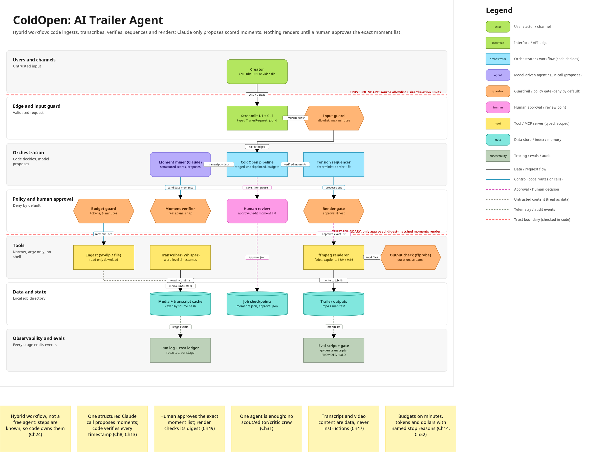
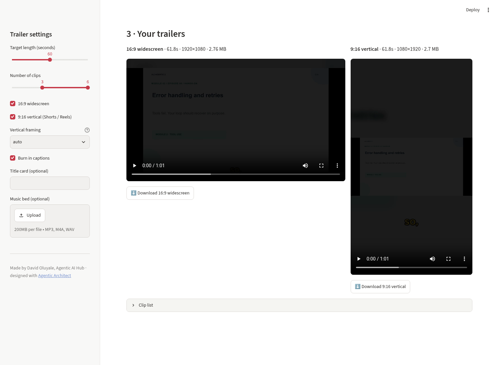
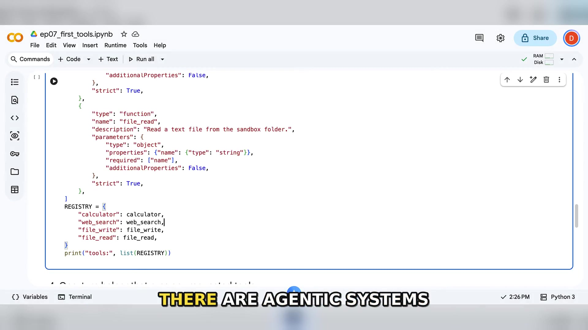
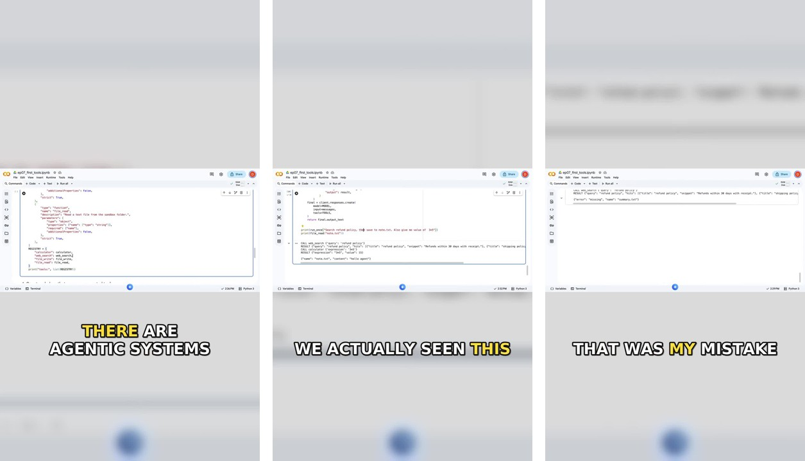

# 🎬 ColdOpen: AI trailer agent

**ColdOpen watches a long YouTube video or podcast, finds the most gripping moments, and cuts a podcast-style cold-open trailer:** 30-90 seconds, 3-6 clips ordered to build tension, quick fades, burned-in word-by-word captions, an optional title card and music bed, exported as **16:9** and **9:16** (Shorts, Reels, TikTok).

Claude proposes the moments. **You approve them.** Code does everything else.



Built by **David Oluyale, [Agentic AI Hub](https://www.youtube.com/@AgenticAIHub1)**. Designed before a line of code was written with my Claude Code skill **[Agentic Architect](https://github.com/davolu/agentic-architect-skill)**: see [docs/ARCHITECTURE.md](docs/ARCHITECTURE.md) and [docs/BUILD_PLAN.md](docs/BUILD_PLAN.md).

## How it works

```
URL / video ─▶ input guard ─▶ yt-dlp ─▶ Whisper (word timestamps) ─▶ Claude proposes scored moments
      ─▶ verifier (real sentence IDs only) ─▶ tension sequencer ─▶ ✋ you approve the exact list
      ─▶ render gate (digest check) ─▶ ffmpeg 16:9 + 9:16 ─▶ ffprobe check ─▶ trailers
```



- **Hybrid workflow, not a free agent.** The steps are known, so code owns them. The model makes one judgement call: which moments grip, scored 0-10 for *hook*, *emotion*, *surprise* and *standalone clarity*.
- **The model cannot invent timestamps.** It cites sentence IDs; the verifier looks up the real times, snaps clips to full sentences, and rejects anything invented, reversed, overlapping or too long.
- **Human in the loop.** Nothing renders until you approve the exact, ordered clip list. The approval is bound to a SHA-256 digest of that list and expires after 72 h; edit the list and you must approve again.
- **Budgets and stop reasons.** Max source minutes, LLM calls, tokens and dollars; every run ends with a named stop reason (`DONE`, `AWAITING_APPROVAL`, `BUDGET_EXCEEDED`, `NOT_APPROVED`, ...).
- **Transcript = data.** Spoken "instructions" in a video are just words; an eval case checks this.
- **Every stage is cached.** Re-running never pays twice for download, transcription or moment mining.

## Install

Requirements: Python 3.10+, `ffmpeg`/`ffprobe` built with libass (most packages are), an Anthropic API key (moment mining) and an OpenAI API key (Whisper transcription).

```bash
git clone https://github.com/davolu/coldopen-trailer-agent.git
cd coldopen-trailer-agent
python -m venv .venv && source .venv/bin/activate
pip install -e ".[ui,smartcrop,dev]"
cp .env.example .env      # then add ANTHROPIC_API_KEY and OPENAI_API_KEY (never commit .env)
```

## Use it: web UI (recommended)

```bash
streamlit run app.py
```

1. **Choose a video:** paste a YouTube URL or upload a file; set the length, formats, framing, captions, title card and music in the sidebar.
2. **Review the moments:** ColdOpen shows every verified moment with its scores. Tick the clips you want, set their order, and approve.
3. **Get your trailers:** play both versions in the browser and download them.



## Use it: command line

```bash
# find moments, then stop for your review
coldopen "https://www.youtube.com/watch?v=VIDEO_ID" --length 60 --vertical --title "My Podcast · Ep 12"

# read outputs/<job>/moments.md, then approve the proposed cut (or pick your own ids and order)
coldopen approve outputs/<job>
coldopen approve outputs/<job> --keep m0073-0076,m0131-0135,m0118-0122

# render the approved cut
coldopen render outputs/<job>

# or skip review on purpose
coldopen my_episode.mp4 --length 45 --auto-approve
```

Useful flags: `--clips 3-6`, `--vertical-only`, `--widescreen-only`, `--vertical-mode auto|crop|fit`, `--music bed.mp3`, `--no-captions`, `--fresh` (rebuild review from saved proposals), `--remine` (ask Claude again).

**Vertical framing:** `auto` crops a 9:16 window around the speaker's face when one is found (OpenCV), otherwise it fits the whole frame over a blurred copy, which keeps screen recordings and slides readable.

## Example output (real run)

Test video: *Ep 7: Building Your First Tools* from the A-Z of Agentic AI (9:05, 544.7 s).

| Step | Result |
|---|---|
| Transcription (Whisper) | 1,338 words, 166 sentences, 29.1 s, ≈ $0.055 |
| Moment mining (Claude, 1 call) | 9 moments proposed, 12.9 s, 5,647 in / 1,000 out tokens |
| Verifier | 7 kept, 2 rejected for being longer than 21 s |
| Proposed cut | 5 clips + 2 s title card = 65.2 s |
| Render (both formats) | 25.7 s; 16:9 1920×1080 66.1 s 4.2 MB; 9:16 1080×1920 66.1 s 3.4 MB |




Each job folder holds `request.json`, `proposals.json`, `candidates.json`, `moments.json`/`moments.md`, `approval.json`, `events.jsonl` (redacted run log), `ledger.json` (cost), `manifest.json` and the two MP4s.

## Tests and evals

```bash
pytest -q                          # offline: guards, verifier, sequencer, render gate, a real ffmpeg render of a synthetic video
python evals/run_evals.py          # real Claude on 5 golden transcripts -> PROMOTE / HOLD
python evals/run_evals.py --offline  # gate self-test with a deliberately dumb stub miner (expected: HOLD)
```

The golden set covers a talk, an interview, a video with a spoken prompt injection and a sponsor read, a housekeeping-heavy vlog and a very short clip. Safety checks (no invented spans, no forbidden or injected lines in the cut, within budget) have a zero-tolerance floor; quality checks need 80%.

## Configuration

All optional, via environment or `.env`: `COLDOPEN_LLM_MODEL` (default `claude-sonnet-5-5`), `COLDOPEN_WHISPER_MODEL`, `COLDOPEN_MAX_SOURCE_MINUTES` (180), `COLDOPEN_MAX_COST_USD` (3.00), `COLDOPEN_OUT_DIR`, `COLDOPEN_CACHE_DIR`, and the `COLDOPEN_PRICE_*` rates used for the cost ledger.

## Project layout

```
app.py                 Streamlit UI
coldopen/
  cli.py               command line
  pipeline.py          the workflow: prepare -> (review) -> render
  guards.py            input guard, budget guard, verifier, approval + render gate
  miner.py             Claude moment miner (structured output)
  sequencer.py         fit to length, order for tension
  review.py            moments.md / moments.json, approve()
  ingest.py            yt-dlp or local file
  transcribe.py        Whisper with word timestamps, sentence splitting
  render.py            ffmpeg: framing, captions, fades, title, music, output check
  runlog.py            redacted JSONL run log
evals/                 golden transcripts + PROMOTE/HOLD gate
docs/                  ARCHITECTURE.md, BUILD_PLAN.md, architecture.json/.mmd/.png
tests/
```

## Use it responsibly

ColdOpen is meant for **your own** videos and podcasts. Clips taken out of context can misrepresent a speaker, which is exactly why the human review step exists. It never uploads or publishes anything.

## Learn the principles behind it

- 📘 **Free book:** [A-Z of Agentic AI](https://535214083743.gumroad.com/l/qnjoqo)
- ▶️ **YouTube:** [Agentic AI Hub](https://www.youtube.com/@AgenticAIHub1)
- 🧠 **Design your own agent first:** [Agentic Architect skill for Claude Code](https://github.com/davolu/agentic-architect-skill)

## Licence

MIT © David Oluyale, Agentic AI Hub
