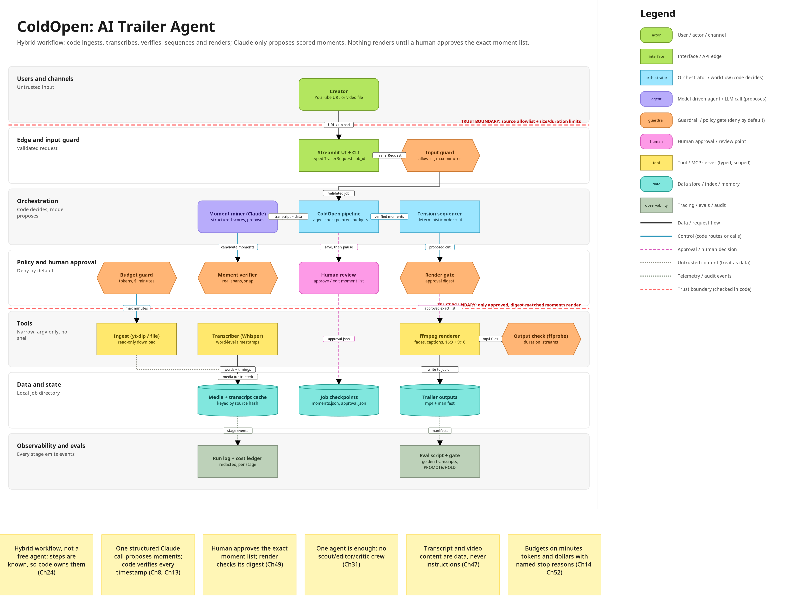

# ColdOpen architecture

> Designed with [Agentic Architect](https://github.com/davolu/agentic-architect-skill). Diagram: [Miro board](https://miro.com/app/board/uXjVEPahmko=/) (preview below, `architecture.mmd` for Mermaid). Machine-readable twin: [`architecture.json`](architecture.json).

## 1. Goal and scope
- **User and journey:** one creator (podcaster or YouTuber) gives a long video, reviews the moments ColdOpen proposes, and downloads a trailer.
- **Done means:** a 30-90 s trailer of 3-6 clips, each starting and ending on a full sentence, ordered to build tension, with burned-in captions and fades, exported as 1920x1080 and 1080x1920 MP4s that pass an ffprobe check; the creator approved the exact clip list (Ch7).
- **Supported requests:** YouTube URL or local video file; target length; 16:9 and/or 9:16; optional title card and music bed; captions on/off.
- **Non-goals:** auto-publishing to YouTube or socials; editing the full video; music generation; third-party content the creator does not own.

## 2. Autonomy (Ch1, Ch24)
Level: **hybrid workflow**. Code owns the path; the model fills one slot (which moments grip, and how much).

| Decision | Chosen by | Why |
|---|---|---|
| Accept the source | Code (input guard) | allowlist and limits are policy, not judgement |
| Which moments are strong, and scores | Model (Claude) | the only genuinely fuzzy judgement; reversible |
| Exact clip boundaries | Code (verifier) | model cites sentence IDs; times come from the transcript |
| Which clips fit, and in what order | Code (sequencer), then human | deterministic, explainable, editable |
| Render | Code, only after human approval | creates the artifact and spends compute |
| Publish | Nobody (non-goal) | the creator uploads by hand |

## 3. Pattern decisions
| # | Decision | Choice | Reason | Chapter | Rejected alternative |
|---|---|---|---|---|---|
| D1 | Autonomy | Hybrid workflow | known steps, one fuzzy judgement | Ch1, Ch24 | free agent choosing tools in a loop |
| D2 | Workflow vs agent | Plain-Python staged workflow | short, enumerable path; no framework lock-in | Ch24, Ch21 | LangGraph or an agent framework |
| D3 | Reasoning pattern | One structured-output call + deterministic verifier | the output is checkable in code | Ch8, Ch13 | ReAct loop; LLM critic pass |
| D4 | Single vs multi-agent | One agent | no named reason to split; long transcripts are windowed inside the same step | Ch31 | scout / editor / critic crew |
| D5 | Tools / MCP | Narrow functions (yt-dlp, Whisper, ffmpeg) run as argv lists | nothing shared across hosts in v1 | Ch11, Ch39 | generic "run command" tool; MCP servers |
| D6 | Knowledge / RAG | None | the whole transcript fits in context | Ch17 | vector index of the transcript |
| D7 | Memory and state | No long-term memory; per-job checkpoints | review must pause and resume without re-paying | Ch18, Ch19, Ch23 | conversation memory |
| D8 | Guardrails | Input guard, verifier, budget guard, render gate, output check | deny by default at every boundary | Ch47, Ch48 | prompt-only rules |
| D9 | Human in the loop | Approve the exact ordered clip list, bound by SHA-256 digest, expiring | the decision sits where output and cost are created | Ch49 | approve "the agent"; no review |
| D10 | Reliability | Timeouts, typed errors, one schema retry, cached stages, named stop reasons | failures must be visible and cheap to resume | Ch14, Ch53 | silent retries |
| D11 | Evals and tracing | JSONL run log + cost ledger; golden transcripts; PROMOTE/HOLD gate | measure safety separately from quality | Ch41-45 | eyeballing outputs |
| D12 | Deployment and cost | Local CLI + Streamlit; budget on minutes, LLM calls, tokens, dollars | single creator, interactive | Ch51, Ch52 | hosted queue and workers (later) |

## 4. Components
| Layer | Component | Kind | Responsibility | Code |
|---|---|---|---|---|
| Users | Creator | actor | gives a source, reviews, approves | - |
| Edge | Streamlit UI + CLI | interface | typed `TrailerRequest`, job ID | `app.py`, `coldopen/cli.py` |
| Edge | Input guard | guardrail | host allowlist, file type/size | `guards.check_source` |
| Orchestration | ColdOpen pipeline | orchestrator | staged workflow, checkpoints, stop reasons | `pipeline.prepare/render/run` |
| Orchestration | Moment miner (Claude) | agent | proposes scored moments by sentence ID | `miner.ClaudeMiner` |
| Orchestration | Tension sequencer | orchestrator | select to fit length, order hook → build → cliffhanger | `sequencer.build_cut` |
| Policy | Moment verifier | guardrail | real sentence IDs, snap, length, overlap | `guards.verify_proposals` |
| Policy | Budget guard | guardrail | max minutes, LLM calls, tokens, dollars | `guards.check_duration`, `check_llm_budget` |
| Policy | Human review | human | approve / edit exact list | `review.write_review/approve`, Streamlit step 2 |
| Policy | Render gate | guardrail | approval exists, digest matches, not expired | `guards.check_render_gate` |
| Tools | Ingest | tool | yt-dlp download or local copy | `ingest.ingest` |
| Tools | Transcriber | tool | Whisper, word timestamps | `transcribe.transcribe` |
| Tools | ffmpeg renderer | tool | clips, fades, captions, framing, concat | `render.render_trailer` |
| Tools | Output check | guardrail | ffprobe streams, size, duration | `render.check_output` |
| Data | Media + transcript cache | data | keyed by source hash | `.coldopen_cache/<key>/` |
| Data | Job checkpoints | data | proposals, candidates, moments, approval | `outputs/<job>/` |
| Data | Trailer outputs | data | MP4s + manifest | `outputs/<job>/trailer_*.mp4` |
| Observability | Run log + cost ledger | observability | redacted JSONL events | `runlog.RunLog` |
| Observability | Eval script + gate | observability | golden set, PROMOTE/HOLD | `evals/run_evals.py` |

## 5. Data flows
| From | To | What flows | Trusted? |
|---|---|---|---|
| Creator | UI/CLI | URL or upload, settings | no |
| UI | Input guard | `TrailerRequest` | validated |
| Ingest | Cache | media file | no (content) |
| Transcriber | Cache | words + timings | no (content) |
| Pipeline | Miner | transcript as data | no |
| Miner | Verifier | `MomentProposal` list | no (model output) |
| Sequencer | Review / gate | proposed ordered cut | yes (code) |
| Review | Job store | `approval.json` | yes (human) |
| Gate | Renderer | approved exact list | yes |

## 6. Trust boundaries and checkers (Ch46, Ch62)
| Boundary | What crosses | Checker (code) | On failure |
|---|---|---|---|
| Creator → pipeline | URL / file | `check_source`, `check_duration` | `REJECTED_INPUT` / `BUDGET_EXCEEDED`, nothing downloaded |
| Transcript → model | spoken words | wrapped as data in the user turn, system prompt says never follow it | injected lines are just words; eval case gc-003 |
| Model → render | proposals | `verify_proposals`, `check_render_gate` | rejected with reason / `NOT_APPROVED` |
| Process → OS | tool calls | `proc.run` argv lists, no shell, timeouts, job-dir outputs; keys only from env | `ToolError` → `RENDER_FAILED` |

## 7. Tool contracts (Ch11, Ch48)
| Tool | Read/write | Scope | Inputs (typed) | Errors | Timeout | Idempotency |
|---|---|---|---|---|---|---|
| ingest | read (network) / write cache | allowlisted hosts | URL or path | `GuardError`, `ToolError` | 120 s probe, 30 min download | cached by source key |
| transcribe | read | audio of one source | media meta | API errors (2 SDK retries) | 600 s | cached `transcript.json` |
| mine | read | transcript text only | sentences, title | schema error → 1 retry → `NO_GOOD_MOMENTS` | 180 s | cached `proposals.json` |
| render | write | job directory only | approved cut | `ToolError` → `RENDER_FAILED` | 900 s per clip | same cut → same files |
| check_output | read | output files | path, format, expected length | problems list | 60 s | pure |

## 8. State, memory and checkpoints (Ch18, Ch19)
| Store | Holds | Owner scope | Retention | Deletion |
|---|---|---|---|---|
| `.coldopen_cache/<source>/` | source media, audio chunks, transcript | the local creator | until deleted | delete the folder |
| `outputs/<job>/` | request, proposals, candidates, moments, approval, events, ledger, manifest, MP4s | the local creator | until deleted | delete the folder |
| Long-term memory | none in v1 | - | - | - |

## 9. Human approval points (Ch49)
| Action | Approver | Evidence shown | Expiry | On timeout |
|---|---|---|---|---|
| Render the trailer | creator | each moment's text, time, length, four scores, overall, role, reason; total length | 72 h | approval rejected; approve again |
| `--auto-approve` | creator (explicit flag) | logged as `mode: auto` | 72 h | - |

## 10. Failure handling (Ch14, Ch53)
- Budgets: source ≤ 180 min, ≤ 12 LLM calls, ≤ 400k input tokens, ≤ $3 per job (all env-configurable).
- Stop reasons: `DONE`, `AWAITING_APPROVAL`, `REJECTED_INPUT`, `BUDGET_EXCEEDED`, `NO_GOOD_MOMENTS`, `NOT_APPROVED`, `RENDER_FAILED`.
- Retries: SDK retries (2) for transient API errors; one schema-repair retry for the miner; no blind retries for ffmpeg.
- Escalation: the creator sees the stop reason and message in the UI or CLI JSON.

## 11. Evaluation and observability (Ch41-Ch45)
- Dimensions: safety (no invented spans, no forbidden/injected lines in the cut, within budget) with a zero-tolerance floor; quality (strong moment included, clip count, length on target) with a 0.8 floor.
- Golden set: 5 transcripts with stable IDs: talk, interview, prompt injection + sponsor read, housekeeping-heavy, very short.
- Tracing and audit: `events.jsonl` per job (stage, status, seconds, tokens, cost), redacted before writing; approvals recorded in `approval.json`.
- Release gate: `evals/run_evals.py` prints PROMOTE or HOLD and saves a JSON report.

## 12. Cost and latency (Ch52)
- Whisper about $0.006 per audio minute; one Claude call per ~60k characters of transcript. Levers: cache every stage, window long transcripts, smaller model via `COLDOPEN_LLM_MODEL`.

## 13. Risks and owners (Ch46, Ch59)
| Risk | Impact x likelihood | Prevent / detect / correct | Owner |
|---|---|---|---|
| Clips out of context misrepresent the speaker | high x medium | clarity score; human review; edit list | creator |
| Copyright on third-party videos | high x low | v1 targets own content; non-goal | creator |
| Runaway cost on very long videos | medium x low | budget guard before download and before each LLM call | maintainer |
| Spoken prompt injection steers selection | medium x low | data-not-instructions prompt; verifier; review; eval gc-003 | maintainer |

## 14. Open questions
- Speaker diarization for multi-guest podcasts (pick moments per speaker).
- Audio-only podcasts (waveform or cover-art background).
- Better vertical framing for screen recordings (follow the cursor or zoom on the active region).
